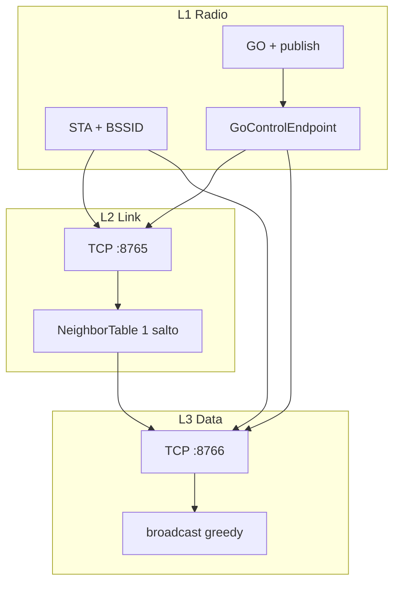

# 13 — Modelo por capas

**Versión:** 0.3.0 (lib-pct-core 2.3.0)  
**Código:** `Radio` (L1), `Link` (L2), `Data` (L3) detrás de `MultiHopProtocol`.  
**Relacionado:** [14-link-layer.md](14-link-layer.md), [15-network-layer.md](15-network-layer.md), [04-link-model-go-legacy.md](04-link-model-go-legacy.md).

---

## 1. Mapa

| Capa | Clase | Qué hace | Transporte |
|---|---|---|---|
| **L1** | `radio/Radio` | Browse DNS-SD (GO apagado) → STA al padre → `createGroup` + publish `_pct-ctrl` | 802.11 P2P + STA legacy |
| **L2** | `link/Link` | TCP `:8765`: PING/PONG, ANNOUNCE/ANNOUNCE_OK, tabla de vecinos a 1 salto | TCP en la red GO / STA |
| **L3** | `data/Data` | TCP `:8766`: broadcast greedy por el árbol | TCP, otro puerto |
| **App** | demo `app-demo` | `send` / `pop`; el nombre del origen sale de la tabla L2 | bytes opacos |

**Regla:** arriba de L2 solo hay `node_id`. Las IP (IPv4 del GO, `fe80` de la STA) no salen de L1/L2.

El flag que deja correr L2 y L3 es `role != ISLAND`. L1 pone `ROOT` o `BRIDGE` cuando ya hay GO.

---

## 2. L1 — radio

Orden fijo (igual que [proto-exp01-gostat](../prototype/proto-exp01-gostat/)):

1. Browse **15 s** con GO apagado.
2. Padre solo si el candidato es usable (`instance-v1` o TXT completo).
3. **STA** (`requestNetwork`) antes de GO.
4. **GO + publish** `_pct-ctrl._tcp`.
5. Publica `GoControlEndpoint` cuando la interfaz P2P ya tiene IPv4 (y fe80 si aparece). Si ConnectivityManager no expone esa iface, las direcciones salen de `NetworkInterface` ([link-android-known-issues.md](link-android-known-issues.md) LK-08).
6. La STA emite `Network` y el **BSSID real** del padre (`FLAG_INCLUDE_LOCATION_INFO`).

`_pct-seek` y `JOIN_OFFER` del Incremento 1 **no están** en esta build.

---

## 3. L2 — link

Escucha `:8765` en las direcciones del endpoint GO (IPv4 `.1` y `fe80` de esa iface). El hijo conecta por la STA a la `fe80` del padre (EUI-64 del BSSID). Tras PING/PONG + ANNOUNCE/OK, la tabla tiene `UUID · NodeId · IPv4 · saltos`.

Hoy la tabla es **solo vecinos a 1 salto**. No hay gossip de rutas (`TAB` / REACH).

---

## 4. L3 — data

Misma geometría de sockets que L2, puerto **8766**. La sesión de datos solo arranca cuando el vecino ya está en la tabla. El tráfico de usuario es **broadcast greedy**: recibir → dedup → ACK al ingreso → `pop()` → repetir a padre e hijos menos por donde entró. `send(destino, payload)` **ignora** el destino en v1.

---

## 5. Dos puertos

| Puerto | Capa | Contenido |
|---|---|---|
| `:8765` | L2 | Identidad y keep-alive. Magic `PCTG`/`PCTP`/`PCTA`/`PCTO`. |
| `:8766` | L3 | Usuario. Magic `PCTD` + `msg_type`. |

No comparten socket. Si `:8766` se cae y `:8765` sigue, el hijo reintenta el connect de datos; no se tumba el GO.

---

## 6. Decisiones que sí corren

1. DNS-SD es solo L1; credenciales en instance-v1 (el TXT remoto a menudo no llega).
2. Tabla en L2; L3 no mira IPs.
3. Identidad = `node_id` (UUID), nunca MAC.
4. Un padre, N hijos. El sentido de la arista es el del socket (quien hizo STA conecta).
5. Broadcast greedy ahora; unicast con REACH queda para después y no se mezcla en `:8765`.
