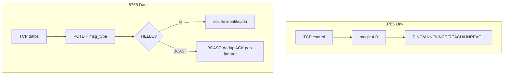

# 16 — Envoltorio en el cable (control vs datos)

**Versión:** 0.3.0 (lib-pct-core 2.3.0)  
**Prerequisito:** [14-link-layer.md](14-link-layer.md), [15-network-layer.md](15-network-layer.md).

El framing `PCT1` de 12 bytes y el DATA unicast con `dst_nid` de [06-tcp-messages.md](06-tcp-messages.md) **no se envían**. Este documento es el wire real.

---

## 1. Dos canales, dos magics

| Canal | Puerto | Magic | Capa |
|---|---|---|---|
| Control | 8765 | 4 ASCII distintos por tipo (`PCTG` `PCTP` `PCTA` `PCTO` `PCTR` `PCTU`) | L2 |
| Datos | 8766 | `PCTD` (4 B) + `msg_type` (1 B, byte 5) | L3 |

No compartir socket. Desde el byte 5 del canal datos ya se sabe qué cuerpo leer; no hay versión. El `dest_uuid` solo va en UNICAST.

Un frame de datos en `:8765` o un magic de control en `:8766` → el lector corta la sesión.

---

## 2. Control `:8765`

Sin header común. El magic de 4 bytes **es** el tipo.

### PING (`PCTG`) / PONG (`PCTP`) — 8 bytes

| Offset | Tamaño | Campo |
|---|---|---|
| 0 | 4 | magic |
| 4 | 4 | `seq` int32 BE |

### ANNOUNCE (`PCTA`) / ANNOUNCE_OK (`PCTO`)

| Offset | Tamaño | Campo |
|---|---|---|
| 0 | 4 | magic |
| 4 | 16 | `node_uuid` |
| 20 | 2 | `name_len` uint16 BE (1..512) |
| 22 | n | `name` UTF-8 |
| 22+n | 4 | IPv4 de esta arista |

### REACH (`PCTR`)

| Offset | Tamaño | Campo |
|---|---|---|
| 0 | 4 | magic |
| 4 | 16 | `node_uuid` del destino |
| 20 | 2 | `name_len` |
| 22 | n | `name` UTF-8 |
| 22+n | 1 | `hops_reportero` uint8 |

Sin IPv4 del destino. El receptor usa la del vecino de ingreso como next-jump y guarda `hops_reportero + 1`. Detalle: [18-unicast-reach.md](18-unicast-reach.md).

### UNREACH (`PCTU`)

| Offset | Tamaño | Campo |
|---|---|---|
| 0 | 4 | magic |
| 4 | 16 | `node_uuid` que ya no se alcanza |

Sin nombre ni hops. Quien detecta la caída borra esa arista (`ipv4OnLink` = next-jump del caído) y flood un `PCTU` por cada UUID borrado. Quien recibe borra solo si su fila tenía ese next-jump = peer de ingreso, y reenvía. Sin fila, L3 no tiene a quién escribir y cierra la sesión de datos hop 1 si existía.

---

## 3. Datos `:8766`

Cabecera: `PCTD` + `msg_type`.

| `msg_type` | Nombre | Cuerpo |
|---|---|---|
| `0x00` | HELLO | `node_uuid` 16 |
| `0x01` | BCAST | `msg_id` uint64 · `origin_uuid` 16 · `ts_ms` int64 · `payload_len` uint16 · `payload` |
| `0x02` | BCAST_RECV | `msg_id` uint64 · `origin_uuid` 16 |
| `0x03` | UNICAST | `msg_id` · `origin_uuid` · `dest_uuid` · `ts_ms` · `payload_len` · `payload` |
| `0x04` | UNICAST_RECV | `msg_id` uint64 · `origin_uuid` 16 |

`payload_len` máximo `0xFFFF`. `ts_ms` es `System.currentTimeMillis()` del emisor (reloj del teléfono); la cola de `send`/`pop` es FIFO, no se ordena por ese campo.

HELLO identifica la sesión (no casar accept por IPv4). BCAST no lleva destino y solo se fan-out a hop 1. UNICAST lleva `dest_uuid`; se escribe en la sesión hop 1 cuya IP es el next-jump de la fila. BCAST_RECV / UNICAST_RECV confirman al vecino de ingreso; no hay ACK extremo a extremo.

---

## 4. Pipelines

---

## 5. Recuperación del canal datos

Si `:8766` muere y `:8765` sigue:

1. L3 cierra esa `DataTcpSession` y la saca del fan-out.
2. El hijo vuelve a `connect` (mismo destino fe80, reintento 2 s).
3. HELLO de nuevo cuando el padre acepte.

No hay `DATA_CHANNEL_RESET` por control. No se llama `removeGroup()` por un fallo solo de datos.

---

## 6. Ejemplo A → B → C (user)

1. C `send`: BCAST local + TCP al padre B.
2. B: BCAST_RECV a C, `pop()`, BCAST a A.
3. A: BCAST_RECV a B, `pop()`.
4. PING/PONG A↔B y B↔C siguen en `:8765` al mismo tiempo.
